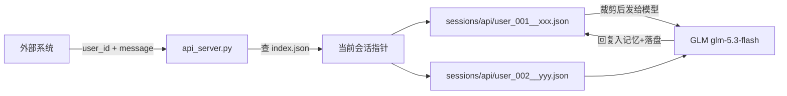

# GLM 对话 HTTP API（api_server.py）

把 `glm_demo.py` 的对话能力封装成 **HTTP 服务**，供外部系统调用。每个调用方传入自己的 `user_id`，服务按 user_id **完全隔离记忆**——同一 user_id 的多轮对话自动共享上下文，不同 user_id 互不可见。

复用 `glm_demo.py` 的全部对话逻辑（构建模型 / 裁剪历史 / 计 token / 会话持久化），只新增 HTTP 层，因此 CLI 具备的多轮记忆、上下文三重限制、流式输出在 API 侧同样生效。

---

## 一、快速开始

### 1. 安装依赖

CLI 依赖之外额外需要：

```powershell
pip install fastapi uvicorn
```

### 2. 配置

`.env` 中配置智谱 API Key（与 CLI 共用），API 专属配置见[第四节](#四配置项)：

```ini
ZHIPUAI_API_KEY=你的智谱API密钥
# 可选：API_KEY=对外发一个密钥即可启用接口鉴权
```

### 3. 启动

```powershell
python api_server.py
# 服务运行在 http://127.0.0.1:8000，交互式文档见 http://127.0.0.1:8000/docs
```

> Windows 终端如出现中文乱码，先执行 `$env:PYTHONIOENCODING = "utf-8"` 再运行。

### 4. 第一条对话

```powershell
curl.exe -s -X POST http://127.0.0.1:8000/chat ^
  -H "Content-Type: application/json" ^
  -d "{\"user_id\": \"user_001\", \"message\": \"你好，介绍一下你自己\"}"
```

```json
{
  "session_id": "20261021_133045_1tlg",
  "reply": "你好！我是由Z.ai训练的GLM大语言模型……",
  "used_tokens": 142,
  "token_budget": 1048576,
  "model_window": 1048576,
  "history_count": 2
}
```

之后**同一 `user_id` 再调用 `/chat` 会自动带上之前的对话历史**，无需客户端传任何历史消息。

---

## 二、接口清单

基础地址：`http://127.0.0.1:8000`（`__main__` 启动默认值，部署时由 uvicorn 参数决定）。

| 方法 | 路径 | 用途 |
|------|------|------|
| GET  | `/health` | 健康检查（**免鉴权**），返回模型名与会话目录 |
| POST | `/chat` | 单轮对话，返回完整回复；自动携带该 user_id 的历史记忆 |
| POST | `/chat/stream` | 流式对话（SSE），逐段返回增量文本 |
| GET  | `/history/{user_id}` | 查看该用户当前会话的完整消息历史 |
| GET  | `/sessions/{user_id}` | 列出该用户的所有会话（含预览、条数、当前会话标记） |
| POST | `/sessions/switch` | 把该用户的"当前会话"切到指定历史会话，后续对话接着它继续 |
| POST | `/sessions/new` | 开新会话：清掉当前会话指针，下次 `/chat` 自动新建 |
| DELETE | `/sessions/{user_id}/{session_id}` | 删除该用户的一个会话文件 |

### 条件冲突处理（工程层）

API 与 CLI 共用同一套**条件账本**（`glm_demo.ConditionLedger`），对调用方透明：

- 每轮 `/chat` / `/chat/stream` 的 `message` 会自动按**轮次/时间戳**记入账本并随会话文件持久化（`conditions` 字段）。
- 消息中出现**显式修正**（"改成 / 不对 / 我是说 / 改为 / 换成了"）时，最新条件直接生效，最近一条生效条件自动**作废**。
- 新消息与既有生效条件**疑似矛盾**时（词面启发式检测），该条件标记「待澄清」，并向模型注入 `[条件一致性提示]`，由模型按系统提示词中的冲突规则先澄清或说明判定理由——**不会静默替调用方取舍**。

### 请求/响应示例

**POST /chat** —— 请求体：

```json
{"user_id": "user_001", "message": "记住暗号是菠萝披萨"}
```

跨轮追问（同一 user_id）：

```json
{"user_id": "user_001", "message": "我说的暗号是什么？"}
```

**POST /chat/stream** —— SSE 响应（`text/event-stream`），事件均为 `data: {JSON}` 行：

```
data: {"session_id": null}                ← 开始事件；新会话时为 null，done 事件里给最终值
data: {"delta": "你"}                     ← 增量文本（若干条）
data: {"delta": "好"}
data: {"done": true, "session_id": "20261021_133045_1tlg", "reply": "你好…",
       "used_tokens": 142, "token_budget": 1048576, "model_window": 1048576,
       "history_count": 2}                ← 正常结束；完整回复已入记忆
```

出错时返回 `data: {"error": "调用模型失败: …"}`，该轮用户消息**不会**写入记忆。

**GET /sessions/{user_id}** —— 响应：

```json
{
  "user_id": "user_001",
  "current": "20261021_133045_1tlg",
  "sessions": [
    {"session_id": "20261021_133045_1tlg", "history_count": 4,
     "updated_at": "2026-10-21 13:30:45", "preview": "记住暗号是菠萝披萨"}
  ]
}
```

**POST /sessions/switch** —— 请求体：`{"user_id": "user_001", "session_id": "20261021_133045_1tlg"}`

### 错误码

| 状态码 | 含义 |
|--------|------|
| 400 | `user_id` 不合法 |
| 401 | 鉴权失败（未配置鉴权时不出现） |
| 404 | 会话 / 用户会话不存在 |
| 422 | 请求体校验失败（缺字段、message 超长等） |
| 502 | 调用模型失败或空回复（该轮不写入记忆，可直接重试） |

---

## 三、user_id 规则与会话隔离

- `user_id` 由**调用方**生成并传入，只允许 `字母 / 数字 / 下划线 / 连字符`，长度 1–64（服务端正则校验，因为它用于拼文件路径，防路径注入）。
- 同一 `user_id` 的并发请求会**串行处理**（进程内按 user 加锁），避免并发写坏会话文件；不同 `user_id` 并行。
- 会话文件命名 `{user_id}__{session_id}.json`，user_id 与 session_id 不会混淆。
- 每个用户维护一个"当前会话"指针，存于 `sessions/api/index.json`；`/sessions/switch`、`/sessions/new` 操作的就是这个指针。



---

## 四、配置项

### 环境变量（`.env` 或系统环境变量，启动前生效）

| 环境变量 | 默认值 | 说明 |
|----------|--------|------|
| `ZHIPUAI_API_KEY` | 无（必填） | 智谱 API 密钥，与 CLI 共用 |
| `API_KEY` | 空（不启用） | **API 鉴权**：非空时所有接口（除 `/health`）要求请求头 `X-API-Key: <值>` |
| `MODEL_CONTEXT_WINDOW` | `1048576`（1M） | 模型上下文窗口（硬上限），与 CLI 共用同一配置 |
| `MAX_CONTEXT_TOKENS` | `0`（=跟随窗口） | 历史 token 预算，永远不会超过窗口 |
| `MAX_MESSAGES` | `40` | 历史消息条数上限（不含系统提示词） |
| `MEMORY_DIR` | `./sessions` | **仅 CLI 会话**目录；API 固定用其下 `sessions/api/` 子目录 |

> 上下文三重限制的裁剪逻辑与 CLI 完全相同（见 README《上下文长度是怎么限制的》），`MODEL_CONTEXT_WINDOW` / `MAX_CONTEXT_TOKENS` / `MAX_MESSAGES` 对 API 同样生效。API 侧暂不支持运行时动态调整，改配置需重启服务。

### 文件存放位置

| 内容 | 位置 |
|------|------|
| API 会话文件 | `sessions/api/{user_id}__{session_id}.json`，每个会话一个 JSON |
| 用户 → 当前会话索引 | `sessions/api/index.json` |
| CLI 会话文件 | `sessions/{session_id}.json`（与 API 隔离，互不可见） |

会话文件格式与 CLI 相同（LangChain `messages_to_dict` 序列化、原子写入），额外多一个 `user_id` 字段；`conditions` 字段保存该会话的条件账本（`{"turn": n, "entries": [...]}`，旧格式文件缺该字段时按空账本处理）。`sessions/` 整体已被 `.gitignore` 排除。

### 与 CLI 的关系

| | CLI（glm_demo.py） | API（api_server.py） |
|---|---|---|
| 会话目录 | `sessions/` 顶层 | `sessions/api/` 子目录 |
| 会话恢复 | 启动时弹菜单，用户自选 | 调用方用 `/sessions/switch` 指定 |
| 上下文限制 | 三重限制，`/window` 等运行时调整 | 三重限制，环境变量配置 |
| 流式输出 | 终端逐字打印 | SSE `/chat/stream` |
| 记忆隔离 | 单机单人 | 按 `user_id` 多用户隔离 |
| 条件账本 | `/conds` 查看变更历史 | 自动随每轮生效，暂无独立查询端点（账本在会话文件 `conditions` 字段） |

CLI 的 `list_sessions` 只扫描 `sessions/` 顶层，**看不到** API 会话；`MEMORY_DIR` 若改到别处，API 的目录也随之迁移（仍在其 `api/` 子目录下）。

---

## 五、项目结构

```
Langchain/
├── glm_demo.py      # 对话核心（模型构建/裁剪/持久化），被 API 复用
├── api_server.py    # HTTP API 层（FastAPI，约 340 行）
├── README.md        # CLI 使用说明与项目总览
├── API.md           # 本文件
├── .env             # ZHIPUAI_API_KEY 等配置（不入库）
├── sessions/        # CLI 会话（每会话一个 JSON）
│   └── api/         # API 会话：{user_id}__{session_id}.json + index.json
└── .gitignore       # 排除 .env / sessions/ 等
```
