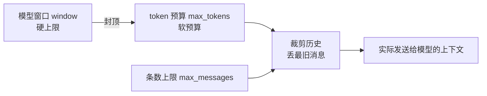
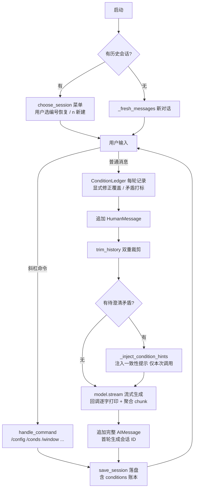

# GLM 多会话对话助手（glm_demo.py）

基于 **LangChain** 通过 OpenAI 兼容接口调用**智谱 GLM**（`glm-5.3-flash`）的命令行对话程序。
按照[智谱官方 LangChain 集成文档](https://docs.bigmodel.cn/cn/guide/develop/langchain/introduction)实现：**流式输出**（`streaming=True` + `StreamingStdOutCallbackHandler`，逐字实时打印）、**多轮对话记忆**、**多会话持久化**（会话文件落盘、启动时自选恢复）、**上下文长度三重限制**（模型窗口 / token 预算 / 消息条数），全部可配置、可运行时动态调整。

---

## 一、快速开始

### 1. 环境要求

- Python 3.10+（代码使用了 `int | None` 等新语法）
- 一个智谱 AI 的 API Key（在 <https://open.bigmodel.cn> 免费获取）

### 2. 安装依赖

```powershell
pip install langchain langchain-openai langchain-core tiktoken python-dotenv
```

### 3. 配置 API Key

在脚本同目录创建 `.env` 文件（已被 `.gitignore` 排除，不会提交）：

```ini
ZHIPUAI_API_KEY=你的智谱API密钥
```

### 4. 运行

```powershell
python glm_demo.py
```

> Windows 终端如出现中文乱码，先执行 `$env:PYTHONIOENCODING = "utf-8"` 再运行。

---

## 二、使用方式

### 启动：由你决定是否恢复上下文

程序启动时会扫描会话目录并列出历史会话，**恢复哪个、是否新开，完全由用户决定**，程序不替你做主：

```
可用会话（按最后保存时间排序）:
  1. [10-21 12:14] 20261021_121459_0tyo  2条  | 我叫小明，25岁，爱吃火锅。
  2. [10-21 12:14] 20261021_121452_godc  2条  | 你好，请用五个字以内回复。
  n. 开始新对话
选择要恢复的会话编号（直接回车=新对话）:
```

| 输入 | 行为 |
|------|------|
| 数字编号（如 `1`） | 恢复该会话的全部上下文，继续对话 |
| `n` / 直接回车 | 开始全新对话 |
| 无效输入 | 提示后开始新对话 |
| 目录里没有历史会话 | 不弹菜单，直接进入新对话 |

几点说明：

- **流式输出**：回复逐字实时打印（按官方文档用 `streaming=True` + `StreamingStdOutCallbackHandler` 实现）；回复完毕后完整内容才写入记忆，因此落盘内容与对话上下文始终完整一致。流式过程中按 `Ctrl+C` 可中断本次回复，中断的内容**不会**写入记忆。
- **首轮真实对话才建档**：新对话在你发出第一条消息后才生成会话 ID（如 `20261021_121459_0tyo`）并落盘；空对话退出不会留下文件。
- **每轮自动保存**：每次模型回复后自动写入会话文件，`Ctrl+C` / `exit` 退出时也会再保存一次。
- **旧版单文件兼容**：如果目录里存在旧版 `memory.json`，启动时会询问"是否导入为会话？[Y/n]"、"是否删除旧记忆文件？[y/N]"。

### 对话中的斜杠命令

| 命令 | 作用 |
|------|------|
| `/config` | 查看当前配置与上下文占用 |
| `/clear` | 清空当前对话记忆（保留系统提示词） |
| `/save` | 立即保存当前会话 |
| `/load` | 重新弹出会话菜单，**切换**到另一个会话 |
| `/conds` | 查看**条件账本**：本会话所有条件的变更历史（生效/作废/待澄清、轮次与时间戳） |
| `/window <n>` | 调整**模型上下文窗口**大小（最小 1024），token 预算会自动封顶到该值 |
| `/tokens <n>` | 调整发送给模型的**历史 token 预算**（最小 64，不能超过窗口） |
| `/msgs <n>` | 调整**历史消息条数上限**（最小 2，不含系统提示词） |
| `exit` / `quit` / `q` | 退出（自动保存） |

例：

```
/window 131072      # 换用 128K 窗口的模型时改小窗口
/tokens 32768       # 只保留最近约 32K token 的历史
/msgs 20            # 历史最多保留 20 条
```

### 上下文长度是怎么限制的

三层限制，逐层收紧：



1. **模型窗口**（`window`）：模型能接受的总上下文硬上限。`glm-5.3-flash` 官方为 **1M**（1048576）。换用窗口更小的模型时必须同步调小。
2. **token 预算**（`max_tokens`）：每次请求允许携带的最大 token 数，默认等于窗口；超出时**从最旧的消息开始丢弃**（始终保留开头的系统提示词和最新一条消息）。建议留出输出空间——输出 token 也占窗口。
3. **条数上限**（`max_messages`）：历史消息最多保留多少条，同样从最旧处裁剪。

> token 数用 `tiktoken` 的 `cl100k_base` 近似估算。GLM 分词器与之不完全一致，该估算对中文**偏保守（略高于实际）**，因此只会提前裁剪、不会撑爆上下文。

---

## 三、会话文件存放位置

| 内容 | 默认位置 | 可通过环境变量修改 |
|------|----------|--------------------|
| 会话文件 | 脚本同目录的 `sessions/` 文件夹，**每个会话一个 JSON**，文件名即会话 ID | `MEMORY_DIR` |
| 旧版单文件记忆 | 脚本同目录的 `memory.json`（仅用于一次性导入检测） | `MEMORY_FILE` |
| API Key 等配置 | 脚本同目录的 `.env` | — |

会话文件示例（`sessions/20261021_121459_0tyo.json`）：

```json
{
  "version": 1,
  "session_id": "20261021_121459_0tyo",
  "saved_at": "2026-10-21 12:15:30",
  "messages": [
    {"type": "system", "data": {"content": "你是一个乐于助人的中文助手。…"}},
    {"type": "human",  "data": {"content": "我叫小明，25岁，爱吃火锅。"}},
    {"type": "ai",     "data": {"content": "你好小明！很高兴认识你！…"}}
  ]
}
```

- `messages` 使用 LangChain 官方的 `messages_to_dict` 序列化格式（注意是嵌套的 `{type, data: {content}}` 结构），可无损往返。
- 会话 ID 格式：`年月日_时分秒_4位随机后缀`，避免同一秒创建的两个会话重名。
- 写入采用**原子写**（先写 `.tmp` 再 `os.replace`），进程中断不会留下半截文件。
- 损坏的会话文件会被自动跳过，不影响其他会话；想手动备份/迁移，直接复制整个 `sessions/` 目录即可。
- `sessions/`、`memory.json`、`.env` 均已加入 `.gitignore`。

---

## 四、配置项一览

### 1. 环境变量 / `.env`（启动前配置）

写在 `.env` 文件里（或系统环境变量）：

| 环境变量 | 默认值 | 说明 |
|----------|--------|------|
| `ZHIPUAI_API_KEY` | 无（必填） | 智谱 API 密钥 |
| `MODEL_CONTEXT_WINDOW` | `1048576`（1M） | 模型上下文窗口大小（硬上限）。换模型时同步修改 |
| `MAX_CONTEXT_TOKENS` | `0`（=跟随窗口） | 历史 token 预算；`0` 表示等于窗口值，且永远不会超过窗口 |
| `MAX_MESSAGES` | `40` | 历史消息条数上限（不含系统提示词） |
| `MEMORY_DIR` | `./sessions` | 会话文件存放目录 |
| `MEMORY_FILE` | `./memory.json` | 旧版单文件记忆路径（仅用于导入检测） |

`.env` 示例：

```ini
ZHIPUAI_API_KEY=你的密钥
MODEL_CONTEXT_WINDOW=131072
MAX_MESSAGES=60
MEMORY_DIR=D:\glm_memory\sessions
```

> 项目根目录的 `.env` 已内置这三个上下文配置项（默认注释掉，即用上方默认值）；取消注释即可生效。

### 2. 对话中动态调整（无需重启）

`/window <n>`、`/tokens <n>`、`/msgs <n>` 即改即生效并立即触发一次历史裁剪；`/config` 随时查看三者当前值与占用。**运行时调整不修改 `.env`，只影响本次运行。**

### 3. 代码内常量（改模型/改提示词时）

位置：`glm_demo.py` 顶部常量区与 `build_model()`：

| 常量/位置 | 当前值 | 说明 |
|-----------|--------|------|
| `ZHIPU_BASE_URL` | `https://open.bigmodel.cn/api/paas/v4/` | 智谱 OpenAI 兼容接口地址 |
| `build_model()` 中 `model` | `glm-5.3-flash` | 模型名；`temperature=0.7`、`max_retries=2` |
| `build_model()` 中 `streaming` / `callbacks` | `True` / `StreamingStdOutCallbackHandler` | 流式输出（官方 LangChain 集成文档推荐配置），改 `False` 可退回整段输出 |
| `SYSTEM_PROMPT`（被 `_fresh_messages()` 使用） | 见 glm_demo.py 常量区 | 每个新会话的系统提示词，内置**条件冲突处理规则**（显式修正直接覆盖 / 隐式矛盾必须澄清 / 无法澄清取最新并声明假设 / 硬约束优先于软偏好 / 绝不静默替用户取舍）；工程层由 `ConditionLedger` 条件账本配套落地 |
| `ConditionLedger` | glm_demo.py 条件冲突处理区 | 条件账本类：每轮记录用户条件（轮次/时间戳版本化），显式修正自动作废旧条件，疑似矛盾打「待澄清」标并注入一致性提示；随会话持久化（`/conds` 查看历史） |

---

## 五、项目结构

```
Langchain/
├── glm_demo.py      # 全部逻辑（单文件，约 320 行）
├── .env             # API Key 与可选配置（不入库）
├── .gitignore       # 排除 .env / sessions/ / memory.json 等
├── sessions/        # 运行后自动生成：每会话一个 JSON 文件
└── README.md        # 本文件
```

## 六、代码导览（给后来者）

`glm_demo.py` 自上而下分七块，读代码按此顺序即可：

1. **常量区**：三个上下文限制的默认值（环境变量在这里被读取）；`_ENCODER` 是 token 估算器。
2. **模型构建**：`count_tokens()` 估算一次请求的总 token；`build_model()` 创建 `ChatOpenAI`（OpenAI 兼容协议指向智谱）；`clamp_budget_to_window()` 保证预算 ≤ 窗口。
3. **多会话持久化**：
   - `_session_path()` / `_new_session_id()`：会话文件路径与 ID 生成；
   - `list_sessions()`：扫描目录返回会话列表（按修改时间倒序，含条数和第一条用户消息预览，30 字截断；损坏文件静默跳过）；
   - `save_session()` / `load_session()`：原子写入与读取，加载时校验首条必须是 `SystemMessage`；同时读写 `conditions` 条件账本字段（旧格式缺省为空账本）。
4. **裁剪**：`trim_history(messages, max_tokens, max_messages)` 实现"条数 + token"双重裁剪，永远保留开头的系统提示词。
5. **条件账本（冲突处理工程层）**：`ConditionLedger` 类按轮次/时间戳版本化记录用户条件；`_extract_condition_topics()` / `_looks_like_conflict()` 做词面级矛盾启发式检测；`_inject_condition_hints()` 在存在「待澄清」矛盾时向模型注入一致性提示（只影响当次调用，不写入会话历史）。账本通过 `save_session()` / `load_session()` 的 `conditions` 字段随会话持久化（旧格式文件缺该字段时按空账本处理）。
6. **启动菜单**：`_fresh_messages()` 用 `SYSTEM_PROMPT`（含条件冲突处理规则）生成新对话初始消息；`_maybe_import_legacy()` 处理旧版 `memory.json` 的导入询问；`choose_session()` 列菜单、解析用户选择，返回 `(会话ID或None, 消息列表, 条件账本)`。
7. **主循环**：`handle_command()` 处理全部斜杠命令（含 `/conds` 查看条件变更历史）；`main()` 串起"建模型 → 选会话 → 循环（命令 / 对话 → 每轮账本更新+裁剪+落盘）→ 退出保存"。对话部分用 `model.stream()` 流式接收：chunk 由 `StreamingStdOutCallbackHandler` 逐字打印，同时用 `sum(chunks)` 聚合成完整 `AIMessage` 再入记忆；`Ctrl+C` 中断时撤回该轮用户消息、不写记忆。

### 核心数据流



### 常见二次开发指引

- **换模型**：改 `build_model()` 的 `model` 名，并用 `MODEL_CONTEXT_WINDOW`（或 `/window`）设置新模型的窗口大小。
- **换提示词**：改 `SYSTEM_PROMPT` 常量（`_fresh_messages()` 会引用它）；注意旧会话文件里存的是旧提示词，恢复旧会话时以文件内为准。
- **调冲突检测**：显式修正词表在 `ConditionLedger.EXPLICIT_MARKERS`；矛盾启发式在 `_extract_condition_topics()` / `_looks_like_conflict()`（词面级，宁漏报不误报，误判的可共存条件由模型在一致性提示下自行判定）。
- **改模型供应商**：只需换 `ZHIPU_BASE_URL`、`model` 与 `api_key` 的读取来源，其余逻辑与供应商无关。
- **迁移记忆**：复制 `sessions/` 目录；或设置 `MEMORY_DIR` 指向新位置。旧版会话文件（无 `conditions` 字段）可正常加载，账本从空开始。

---

## 七、常见问题

**Q：会话文件能手动删吗？**
可以。删除 `sessions/` 下对应的 JSON 即可，下次启动菜单里就不会出现。

**Q：退出后记忆还在吗？**
在。每轮对话都自动落盘，重启后从启动菜单选择该会话即可无缝继续。

**Q：为什么我调小 `/tokens` 后前面的对话"忘了"？**
这是裁剪机制的预期行为：超出预算时从最旧的消息开始丢弃，模型只看得到保留下来的近期内容。会话文件里保存的是裁剪后的消息列表。

**Q：报错"请先设置环境变量 ZHIPUAI_API_KEY"？**
`.env` 文件不存在或里面没有 `ZHIPUAI_API_KEY`，按"快速开始"第 3 步配置。
